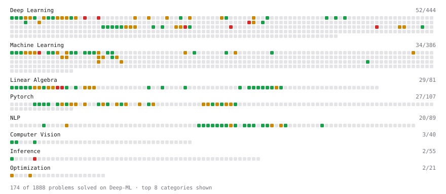

# Deep-ML

My machine learning practice from [Deep-ML](https://www.deep-ml.com). Every solution here was written by hand.

**226** solved · 200 problems · 9 labs · 17 math

[**Browse the interactive portfolio**](https://HanhaiNotHai.github.io/deep-ml/) to replay this filling in over time.

## Problems

| | Difficulty | Solved | |
| --- | --- | --- | --- |
| [Adaptive and Conditional Instance Normalization](https://www.deep-ml.com/problems/1843) | easy | 2026-11-06 | [solution](problems/1843-adaptive-and-conditional-instance-normalization) |
| [Add Positional Embeddings to Token Embeddings](https://www.deep-ml.com/problems/946) | easy | 2026-10-15 | [solution](problems/0946-add-positional-embeddings-to-token-embeddings) |
| [Analyzing Memory Fragmentation in LLM Serving](https://www.deep-ml.com/problems/495) | easy | 2026-10-20 | [solution](problems/0495-analyzing-memory-fragmentation-in-llm-serving) |
| [Apply Dropout to Attention Weights](https://www.deep-ml.com/problems/956) | easy | 2026-10-15 | [solution](problems/0956-apply-dropout-to-attention-weights) |
| [Average Negative Log-Likelihood for Bigram Model](https://www.deep-ml.com/problems/986) | easy | 2026-10-15 | [solution](problems/0986-average-negative-log-likelihood-for-bigram-model) |
| [Backward Pass of Tanh Using Cached Output](https://www.deep-ml.com/problems/999) | easy | 2026-11-03 | [solution](problems/0999-backward-pass-of-tanh-using-cached-output) |
| [Backward Pass of Tensor Reshape](https://www.deep-ml.com/problems/1000) | easy | 2026-11-03 | [solution](problems/1000-backward-pass-of-tensor-reshape) |
| [Batch a TensorDataset with DataLoader](https://www.deep-ml.com/problems/1237) | easy | 2026-09-28 | [solution](problems/1237-batch-a-tensordataset-with-dataloader) |
| [Batch Iterator for Dataset](https://www.deep-ml.com/problems/30) | easy | 2024-08-02 | [solution](problems/0030-batch-iterator-for-dataset) |
| [BatchNorm1d Forward with Bessel's Correction](https://www.deep-ml.com/problems/1003) | easy | 2026-11-04 | [solution](problems/1003-batchnorm1d-forward-with-bessel-s-correction) |
| [Bias-less LayerNorm with Float32 Compute](https://www.deep-ml.com/problems/1042) | easy | 2026-11-06 | [solution](problems/1042-bias-less-layernorm-with-float32-compute) |
| [BPE Decode Token IDs to Text](https://www.deep-ml.com/problems/951) | easy | 2026-10-14 | [solution](problems/0951-bpe-decode-token-ids-to-text) |
| [Build a Dataset and Use It with a DataLoader](https://www.deep-ml.com/problems/899) | easy | 2026-09-28 | [solution](problems/0899-build-a-dataset-and-use-it-with-a-dataloader) |
| [Build a Linear Regression Model with nn.Module](https://www.deep-ml.com/problems/885) | easy | 2026-09-28 | [solution](problems/0885-build-a-linear-regression-model-with-nn-module) |
| [Build an MLP with nn.Sequential](https://www.deep-ml.com/problems/887) | easy | 2026-09-28 | [solution](problems/0887-build-an-mlp-with-nn-sequential) |
| [Build Bigram Count Matrix from Words](https://www.deep-ml.com/problems/983) | easy | 2026-10-15 | [solution](problems/0983-build-bigram-count-matrix-from-words) |
| [Build Vocabulary from Token List](https://www.deep-ml.com/problems/941) | easy | 2026-10-12 | [solution](problems/0941-build-vocabulary-from-token-list) |
| [Calculate 2x2 Matrix Inverse](https://www.deep-ml.com/problems/8) | easy | 2024-07-29 | [solution](problems/0008-calculate-2x2-matrix-inverse) |
| [Calculate Accuracy Score](https://www.deep-ml.com/problems/36) | easy | 2024-08-02 | [solution](problems/0036-calculate-accuracy-score) |
| [Calculate Covariance Matrix](https://www.deep-ml.com/problems/10) | easy | 2024-07-25 | [solution](problems/0010-calculate-covariance-matrix) |
| [Calculate Image Brightness](https://www.deep-ml.com/problems/70) | easy | 2025-10-23 | [solution](problems/0070-calculate-image-brightness) |
| [Calculate Mean by Row or Column](https://www.deep-ml.com/problems/4) | easy | 2024-07-25 | [solution](problems/0004-calculate-mean-by-row-or-column) |
| [Calculate Perplexity for Language Models](https://www.deep-ml.com/problems/320) | easy | 2026-10-12 | [solution](problems/0320-calculate-perplexity-for-language-models) |
| [Calculate Vocabulary Size from Token List](https://www.deep-ml.com/problems/953) | easy | 2026-10-13 | [solution](problems/0953-calculate-vocabulary-size-from-token-list) |
| [Check Linear Independence of Vectors](https://www.deep-ml.com/problems/331) | easy | 2026-11-03 | [solution](problems/0331-check-linear-independence-of-vectors) |
| [Compute Arithmetic Intensity and Classify Bottleneck](https://www.deep-ml.com/problems/414) | easy | 2026-10-19 | [solution](problems/0414-compute-arithmetic-intensity-and-classify-bottleneck) |
| [Compute Multi-class Cross-Entropy Loss](https://www.deep-ml.com/problems/134) | easy | 2026-09-29 | [solution](problems/0134-compute-multi-class-cross-entropy-loss) |
| [Compute the Cross Product of Two 3D Vectors](https://www.deep-ml.com/problems/118) | easy | 2026-11-02 | [solution](problems/0118-compute-the-cross-product-of-two-3d-vectors) |
| [Compute TTFT ITL and TPS from a Token Timestamp Stream](https://www.deep-ml.com/problems/411) | easy | 2026-10-19 | [solution](problems/0411-compute-ttft-itl-and-tps-from-a-token-timestamp-stream) |
| [Construct Causal Attention Mask via tril and triu Methods](https://www.deep-ml.com/problems/965) | easy | 2026-10-16 | [solution](problems/0965-construct-causal-attention-mask-via-tril-and-triu-methods) |
| [Construct Next-Token Prediction Targets](https://www.deep-ml.com/problems/954) | easy | 2026-10-15 | [solution](problems/0954-construct-next-token-prediction-targets) |
| [Conv2d Output Shape](https://www.deep-ml.com/problems/1232) | easy | 2026-10-12 | [solution](problems/1232-conv2d-output-shape) |
| [Convert Vector to Diagonal Matrix](https://www.deep-ml.com/problems/35) | easy | 2024-08-02 | [solution](problems/0035-convert-vector-to-diagonal-matrix) |
| [Cosine LR Schedule with Linear Warmup](https://www.deep-ml.com/problems/910) | easy | 2026-10-09 | [solution](problems/0910-cosine-lr-schedule-with-linear-warmup) |
| [Count Parameters of a Sequential Model](https://www.deep-ml.com/problems/1218) | easy | 2026-09-28 | [solution](problems/1218-count-parameters-of-a-sequential-model) |
| [Create and Inspect a Tensor](https://www.deep-ml.com/problems/1220) | easy | 2026-11-04 | [solution](problems/1220-create-and-inspect-a-tensor) |
| [Derivatives of Activation Functions](https://www.deep-ml.com/problems/217) | easy | 2026-09-29 | [solution](problems/0217-derivatives-of-activation-functions) |
| [Early Stopping Based on Validation Loss Plateau](https://www.deep-ml.com/problems/199) | easy | 2026-10-09 | [solution](problems/0199-early-stopping-based-on-validation-loss-plateau) |
| [Early Stopping with Patience](https://www.deep-ml.com/problems/913) | easy | 2026-10-09 | [solution](problems/0913-early-stopping-with-patience) |
| [Embedding Layer as One-Hot Matrix Multiplication](https://www.deep-ml.com/problems/947) | easy | 2026-10-15 | [solution](problems/0947-embedding-layer-as-one-hot-matrix-multiplication) |
| [Feature Scaling Implementation](https://www.deep-ml.com/problems/16) | easy | 2024-07-31 | [solution](problems/0016-feature-scaling-implementation) |
| [Find Most Frequent Token Pair for BPE](https://www.deep-ml.com/problems/948) | easy | 2026-10-14 | [solution](problems/0948-find-most-frequent-token-pair-for-bpe) |
| [Flip an Image Horizontally or Vertically](https://www.deep-ml.com/problems/238) | easy | 2026-10-20 | [solution](problems/0238-flip-an-image-horizontally-or-vertically) |
| [Fold BatchNorm into the Preceding Convolution](https://www.deep-ml.com/problems/1840) | easy | 2026-11-04 | [solution](problems/1840-fold-batchnorm-into-the-preceding-convolution) |
| [Gemma-Style RMSNorm with Optional Scale](https://www.deep-ml.com/problems/1047) | easy | 2026-11-06 | [solution](problems/1047-gemma-style-rmsnorm-with-optional-scale) |
| [Generate Input-Target Batches for Language Model Training](https://www.deep-ml.com/problems/1080) | easy | 2026-10-15 | [solution](problems/1080-generate-input-target-batches-for-language-model-training) |
| [Gradient of a Square with Autograd](https://www.deep-ml.com/problems/1222) | easy | 2026-11-04 | [solution](problems/1222-gradient-of-a-square-with-autograd) |
| [Grayscale Image Contrast Calculator](https://www.deep-ml.com/problems/82) | easy | 2025-10-23 | [solution](problems/0082-grayscale-image-contrast-calculator) |
| [Greedy Autoregressive Text Generation](https://www.deep-ml.com/problems/1070) | easy | 2026-10-16 | [solution](problems/1070-greedy-autoregressive-text-generation) |
| [Implement Bias-less Cohere LayerNorm](https://www.deep-ml.com/problems/1039) | easy | 2026-11-06 | [solution](problems/1039-implement-bias-less-cohere-layernorm) |
| [Implement Dropout from Scratch](https://www.deep-ml.com/problems/901) | easy | 2026-09-30 | [solution](problems/0901-implement-dropout-from-scratch) |
| [Implement Early Stopping Based on Validation Loss](https://www.deep-ml.com/problems/135) | easy | 2026-10-09 | [solution](problems/0135-implement-early-stopping-based-on-validation-loss) |
| [Implement F-Score Calculation for Binary Classification](https://www.deep-ml.com/problems/61) | easy | 2026-07-01 | [solution](problems/0061-implement-f-score-calculation-for-binary-classification) |
| [Implement He Weight Initialization](https://www.deep-ml.com/problems/290) | easy | 2026-11-04 | [solution](problems/0290-implement-he-weight-initialization) |
| [Implement LayerNorm from Scratch](https://www.deep-ml.com/problems/908) | easy | 2026-09-30 | [solution](problems/0908-implement-layernorm-from-scratch) |
| [Implement Precision Metric](https://www.deep-ml.com/problems/46) | easy | 2026-07-01 | [solution](problems/0046-implement-precision-metric) |
| [Implement Recall Metric in Binary Classification](https://www.deep-ml.com/problems/52) | easy | 2026-07-01 | [solution](problems/0052-implement-recall-metric-in-binary-classification) |
| [Implement ReLU Activation Function](https://www.deep-ml.com/problems/42) | easy | 2026-07-01 | [solution](problems/0042-implement-relu-activation-function) |
| [Implement Ridge Regression Loss Function](https://www.deep-ml.com/problems/43) | easy | 2026-07-01 | [solution](problems/0043-implement-ridge-regression-loss-function) |
| [Implement RMSNorm (Root Mean Square Layer Normalization)](https://www.deep-ml.com/problems/372) | easy | 2026-11-04 | [solution](problems/0372-implement-rmsnorm-root-mean-square-layer-normalization) |
| [Implement SwiGLU activation function](https://www.deep-ml.com/problems/156) | easy | 2026-11-03 | [solution](problems/0156-implement-swiglu-activation-function) |
| [Implement the Hardtanh Activation Function](https://www.deep-ml.com/problems/266) | easy | 2026-11-03 | [solution](problems/0266-implement-the-hardtanh-activation-function) |
| [Implement the Mish Activation Function](https://www.deep-ml.com/problems/262) | easy | 2026-11-03 | [solution](problems/0262-implement-the-mish-activation-function) |
| [Implement the Square ReLU Activation Function](https://www.deep-ml.com/problems/373) | easy | 2026-11-03 | [solution](problems/0373-implement-the-square-relu-activation-function) |
| [Implement the Tanh Activation Function](https://www.deep-ml.com/problems/264) | easy | 2026-11-03 | [solution](problems/0264-implement-the-tanh-activation-function) |
| [Implement Xavier/Glorot Weight Initialization](https://www.deep-ml.com/problems/369) | easy | 2026-11-04 | [solution](problems/0369-implement-xavier-glorot-weight-initialization) |
| [Implementation of Log Softmax Function](https://www.deep-ml.com/problems/39) | easy | 2026-06-30 | [solution](problems/0039-implementation-of-log-softmax-function) |
| [KL Divergence Between Two Normal Distributions](https://www.deep-ml.com/problems/56) | easy | 2026-07-01 | [solution](problems/0056-kl-divergence-between-two-normal-distributions) |
| [L2 Normalization Along an Axis](https://www.deep-ml.com/problems/1022) | easy | 2026-11-02 | [solution](problems/1022-l2-normalization-along-an-axis) |
| [Laplace Smoothing for Bigram Probabilities](https://www.deep-ml.com/problems/987) | easy | 2026-10-15 | [solution](problems/0987-laplace-smoothing-for-bigram-probabilities) |
| [Leaky ReLU Activation Function](https://www.deep-ml.com/problems/44) | easy | 2026-07-01 | [solution](problems/0044-leaky-relu-activation-function) |
| [Linear Kernel Function](https://www.deep-ml.com/problems/45) | easy | 2026-07-01 | [solution](problems/0045-linear-kernel-function) |
| [Linear Regression Using Gradient Descent](https://www.deep-ml.com/problems/15) | easy | 2024-07-29 | [solution](problems/0015-linear-regression-using-gradient-descent) |
| [Linear Regression Using Normal Equation](https://www.deep-ml.com/problems/14) | easy | 2024-07-29 | [solution](problems/0014-linear-regression-using-normal-equation) |
| [Matrix Determinant & Trace](https://www.deep-ml.com/problems/195) | easy | 2026-11-02 | [solution](problems/0195-matrix-determinant-trace) |
| [Matrix-Vector Dot Product](https://www.deep-ml.com/problems/1) | easy | 2024-07-25 | [solution](problems/0001-matrix-vector-dot-product) |
| [One SGD Update Step](https://www.deep-ml.com/problems/1234) | easy | 2026-09-28 | [solution](problems/1234-one-sgd-update-step) |
| [One-Hot Encoding of Nominal Values](https://www.deep-ml.com/problems/34) | easy | 2024-08-02 | [solution](problems/0034-one-hot-encoding-of-nominal-values) |
| [Pad and Truncate Tokenized Sequences](https://www.deep-ml.com/problems/1059) | easy | 2026-10-15 | [solution](problems/1059-pad-and-truncate-tokenized-sequences) |
| [Pairwise Cosine Similarity Matrix](https://www.deep-ml.com/problems/1072) | easy | 2026-11-02 | [solution](problems/1072-pairwise-cosine-similarity-matrix) |
| [Random Shuffle of Dataset](https://www.deep-ml.com/problems/29) | easy | 2024-08-01 | [solution](problems/0029-random-shuffle-of-dataset) |
| [Reduce Gradient Across Broadcasted Dimensions](https://www.deep-ml.com/problems/998) | easy | 2026-11-03 | [solution](problems/0998-reduce-gradient-across-broadcasted-dimensions) |
| [Regex-Based Text Tokenizer](https://www.deep-ml.com/problems/940) | easy | 2026-10-12 | [solution](problems/0940-regex-based-text-tokenizer) |
| [Regularization via Information Bottleneck](https://www.deep-ml.com/problems/503) | easy | 2026-11-09 | [solution](problems/0503-regularization-via-information-bottleneck) |
| [Replace Token Pair in BPE Sequences](https://www.deep-ml.com/problems/949) | easy | 2026-10-14 | [solution](problems/0949-replace-token-pair-in-bpe-sequences) |
| [Reshape and Transpose a Tensor](https://www.deep-ml.com/problems/1221) | easy | 2026-11-04 | [solution](problems/1221-reshape-and-transpose-a-tensor) |
| [Reshape Matrix](https://www.deep-ml.com/problems/3) | easy | 2024-07-25 | [solution](problems/0003-reshape-matrix) |
| [Run One Training Step: Forward, Loss, Backward, Optimizer](https://www.deep-ml.com/problems/886) | easy | 2026-09-28 | [solution](problems/0886-run-one-training-step-forward-loss-backward-optimizer) |
| [Save and Load Model Weights with state_dict](https://www.deep-ml.com/problems/888) | easy | 2026-09-28 | [solution](problems/0888-save-and-load-model-weights-with-state-dict) |
| [Scalar Multiplication of a Matrix](https://www.deep-ml.com/problems/5) | easy | 2024-07-26 | [solution](problems/0005-scalar-multiplication-of-a-matrix) |
| [Scale Attention Scores by sqrt(d_k)](https://www.deep-ml.com/problems/963) | easy | 2026-10-15 | [solution](problems/0963-scale-attention-scores-by-sqrt-d-k) |
| [Sigmoid Activation Function Understanding](https://www.deep-ml.com/problems/22) | easy | 2024-08-01 | [solution](problems/0022-sigmoid-activation-function-understanding) |
| [Simple Self-Attention Without Trainable Weights](https://www.deep-ml.com/problems/955) | easy | 2026-10-15 | [solution](problems/0955-simple-self-attention-without-trainable-weights) |
| [Simple Word Tokenizer Encode and Decode](https://www.deep-ml.com/problems/942) | easy | 2026-10-13 | [solution](problems/0942-simple-word-tokenizer-encode-and-decode) |
| [Single Neuron](https://www.deep-ml.com/problems/24) | easy | 2024-08-01 | [solution](problems/0024-single-neuron) |
| [Sliding Window Text Dataset Generator](https://www.deep-ml.com/problems/944) | easy | 2026-10-15 | [solution](problems/0944-sliding-window-text-dataset-generator) |
| [Softmax Activation Function Implementation ](https://www.deep-ml.com/problems/23) | easy | 2024-08-01 | [solution](problems/0023-softmax-activation-function-implementation) |
| [StepLR Learning Rate Scheduler](https://www.deep-ml.com/problems/153) | easy | 2026-10-09 | [solution](problems/0153-steplr-learning-rate-scheduler) |
| [Tensor Puzzle: Extract the Diagonal](https://www.deep-ml.com/problems/1271) | easy | 2026-11-03 | [solution](problems/1271-tensor-puzzle-extract-the-diagonal) |
| [Tensor Puzzle: First-Order Difference](https://www.deep-ml.com/problems/1275) | easy | 2026-11-03 | [solution](problems/1275-tensor-puzzle-first-order-difference) |
| [Tensor Puzzle: Identity Matrix from Comparisons](https://www.deep-ml.com/problems/1272) | easy | 2026-11-03 | [solution](problems/1272-tensor-puzzle-identity-matrix-from-comparisons) |
| [Tensor Puzzle: Ones Vector from First Principles](https://www.deep-ml.com/problems/1268) | easy | 2026-11-03 | [solution](problems/1268-tensor-puzzle-ones-vector-from-first-principles) |
| [Tensor Puzzle: Outer Product via Broadcasting](https://www.deep-ml.com/problems/1270) | easy | 2026-11-03 | [solution](problems/1270-tensor-puzzle-outer-product-via-broadcasting) |
| [Tensor Puzzle: Sum a Vector with a Dot Product](https://www.deep-ml.com/problems/1269) | easy | 2026-11-03 | [solution](problems/1269-tensor-puzzle-sum-a-vector-with-a-dot-product) |
| [Tensor Puzzle: Upper-Triangular Ones Matrix](https://www.deep-ml.com/problems/1273) | easy | 2026-11-03 | [solution](problems/1273-tensor-puzzle-upper-triangular-ones-matrix) |
| [Token Embedding Lookup Table](https://www.deep-ml.com/problems/945) | easy | 2026-10-15 | [solution](problems/0945-token-embedding-lookup-table) |
| [Tokenizer with Unknown and End-of-Text Tokens](https://www.deep-ml.com/problems/943) | easy | 2026-10-13 | [solution](problems/0943-tokenizer-with-unknown-and-end-of-text-tokens) |
| [Transformation Matrix from Basis B to C](https://www.deep-ml.com/problems/27) | easy | 2024-08-01 | [solution](problems/0027-transformation-matrix-from-basis-b-to-c) |
| [Transpose of a Matrix](https://www.deep-ml.com/problems/2) | easy | 2024-07-25 | [solution](problems/0002-transpose-of-a-matrix) |
| [Zero-Initialized RMSNorm with (1+w) Scaling](https://www.deep-ml.com/problems/1046) | easy | 2026-11-06 | [solution](problems/1046-zero-initialized-rmsnorm-with-1-w-scaling) |
| [2D Translation Matrix Implementation](https://www.deep-ml.com/problems/55) | medium | 2026-07-01 | [solution](problems/0055-2d-translation-matrix-implementation) |
| [Adaptive Layer Normalization for Conditional Generation](https://www.deep-ml.com/problems/684) | medium | 2026-11-06 | [solution](problems/0684-adaptive-layer-normalization-for-conditional-generation) |
| [Apply a 2D Convolution](https://www.deep-ml.com/problems/1233) | medium | 2026-10-12 | [solution](problems/1233-apply-a-2d-convolution) |
| [Backpropagation Gradients for a Dense Layer](https://www.deep-ml.com/problems/1076) | medium | 2026-11-03 | [solution](problems/1076-backpropagation-gradients-for-a-dense-layer) |
| [Backpropagation Through a Scalar Chain Network](https://www.deep-ml.com/problems/1075) | medium | 2026-11-03 | [solution](problems/1075-backpropagation-through-a-scalar-chain-network) |
| [Backward Pass of Row-wise Max Operation](https://www.deep-ml.com/problems/1001) | medium | 2026-11-03 | [solution](problems/1001-backward-pass-of-row-wise-max-operation) |
| [BatchNorm1d Forward in Eval Mode](https://www.deep-ml.com/problems/1231) | medium | 2026-09-30 | [solution](problems/1231-batchnorm1d-forward-in-eval-mode) |
| [BatchNorm1d Supporting 2D and 3D Inputs](https://www.deep-ml.com/problems/1005) | medium | 2026-11-04 | [solution](problems/1005-batchnorm1d-supporting-2d-and-3d-inputs) |
| [Beam Search Decoding](https://www.deep-ml.com/problems/385) | medium | 2026-10-19 | [solution](problems/0385-beam-search-decoding) |
| [BPE Encode Text Using Merge Table](https://www.deep-ml.com/problems/950) | medium | 2026-10-14 | [solution](problems/0950-bpe-encode-text-using-merge-table) |
| [Building a Virtual Memory System for KV Cache](https://www.deep-ml.com/problems/493) | medium | 2026-10-20 | [solution](problems/0493-building-a-virtual-memory-system-for-kv-cache) |
| [Byte Pair Encoding (BPE) Tokenizer](https://www.deep-ml.com/problems/380) | medium | 2026-10-14 | [solution](problems/0380-byte-pair-encoding-bpe-tokenizer) |
| [Calculate Eigenvalues of a Matrix](https://www.deep-ml.com/problems/6) | medium | 2024-07-26 | [solution](problems/0006-calculate-eigenvalues-of-a-matrix) |
| [Calculate Number of Parameters in Neural Network](https://www.deep-ml.com/problems/291) | medium | 2026-11-04 | [solution](problems/0291-calculate-number-of-parameters-in-neural-network) |
| [CosineAnnealingLR Learning Rate Scheduler](https://www.deep-ml.com/problems/155) | medium | 2026-10-09 | [solution](problems/0155-cosineannealinglr-learning-rate-scheduler) |
| [Custom Autograd Function: Swish Forward and Backward](https://www.deep-ml.com/problems/1399) | medium | 2026-11-04 | [solution](problems/1399-custom-autograd-function-swish-forward-and-backward) |
| [Derivative of Cross-Entropy Loss w.r.t. Logits](https://www.deep-ml.com/problems/220) | medium | 2026-09-30 | [solution](problems/0220-derivative-of-cross-entropy-loss-w-r-t-logits) |
| [Derivative of Softmax](https://www.deep-ml.com/problems/219) | medium | 2026-09-29 | [solution](problems/0219-derivative-of-softmax) |
| [Divide Dataset Based on Feature Threshold](https://www.deep-ml.com/problems/31) | medium | 2024-08-02 | [solution](problems/0031-divide-dataset-based-on-feature-threshold) |
| [Dropout in Train vs Eval Mode](https://www.deep-ml.com/problems/1230) | medium | 2026-09-30 | [solution](problems/1230-dropout-in-train-vs-eval-mode) |
| [Dropout Layer](https://www.deep-ml.com/problems/151) | medium | 2026-09-30 | [solution](problems/0151-dropout-layer) |
| [Elbow Method for K-Means](https://www.deep-ml.com/problems/827) | medium | 2026-06-26 | [solution](problems/0827-elbow-method-for-k-means) |
| [End-to-End Latency Decomposition](https://www.deep-ml.com/problems/413) | medium | 2026-10-19 | [solution](problems/0413-end-to-end-latency-decomposition) |
| [Entropy & Cross-Entropy](https://www.deep-ml.com/problems/205) | medium | 2026-10-12 | [solution](problems/0205-entropy-cross-entropy) |
| [Gauss-Seidel Method for Solving Linear Systems](https://www.deep-ml.com/problems/57) | medium | 2026-07-01 | [solution](problems/0057-gauss-seidel-method-for-solving-linear-systems) |
| [Generate Random Subsets of a Dataset](https://www.deep-ml.com/problems/33) | medium | 2026-07-01 | [solution](problems/0033-generate-random-subsets-of-a-dataset) |
| [Gradient Accumulation Over Micro-Batches](https://www.deep-ml.com/problems/912) | medium | 2026-10-09 | [solution](problems/0912-gradient-accumulation-over-micro-batches) |
| [Gradient Clipping by Norm](https://www.deep-ml.com/problems/909) | medium | 2026-10-09 | [solution](problems/0909-gradient-clipping-by-norm) |
| [Gradient of a Weighted Sum of Squares](https://www.deep-ml.com/problems/1223) | medium | 2026-11-04 | [solution](problems/1223-gradient-of-a-weighted-sum-of-squares) |
| [Greedy Streaming Decoder with KV Cache](https://www.deep-ml.com/problems/1055) | medium | 2026-10-16 | [solution](problems/1055-greedy-streaming-decoder-with-kv-cache) |
| [Image Segmentation via K-Means Clustering](https://www.deep-ml.com/problems/832) | medium | 2026-06-26 | [solution](problems/0832-image-segmentation-via-k-means-clustering) |
| [Implement a Custom `autograd.Function`](https://www.deep-ml.com/problems/903) | medium | 2026-10-12 | [solution](problems/0903-implement-a-custom-autograd-function) |
| [Implement a ResNet Basic Block](https://www.deep-ml.com/problems/917) | medium | 2026-10-12 | [solution](problems/0917-implement-a-resnet-basic-block) |
| [Implement a Transformer Encoder Block](https://www.deep-ml.com/problems/905) | medium | 2026-10-16 | [solution](problems/0905-implement-a-transformer-encoder-block) |
| [Implement Adam Optimization Algorithm](https://www.deep-ml.com/problems/49) | medium | 2026-07-01 | [solution](problems/0049-implement-adam-optimization-algorithm) |
| [Implement AdamW Optimizer Step](https://www.deep-ml.com/problems/169) | medium | 2026-09-28 | [solution](problems/0169-implement-adamw-optimizer-step) |
| [Implement Batch Normalization for BCHW Input](https://www.deep-ml.com/problems/115) | medium | 2026-09-30 | [solution](problems/0115-implement-batch-normalization-for-bchw-input) |
| [Implement Batched Causal Self-Attention](https://www.deep-ml.com/problems/957) | medium | 2026-10-16 | [solution](problems/0957-implement-batched-causal-self-attention) |
| [Implement BatchNorm2d from Scratch (training mode)](https://www.deep-ml.com/problems/902) | medium | 2026-09-30 | [solution](problems/0902-implement-batchnorm2d-from-scratch-training-mode) |
| [Implement Conv2d with `unfold`](https://www.deep-ml.com/problems/900) | medium | 2026-10-12 | [solution](problems/0900-implement-conv2d-with-unfold) |
| [Implement Gradient Descent Variants with MSE Loss](https://www.deep-ml.com/problems/47) | medium | 2026-07-01 | [solution](problems/0047-implement-gradient-descent-variants-with-mse-loss) |
| [Implement Group Normalization](https://www.deep-ml.com/problems/126) | medium | 2026-09-30 | [solution](problems/0126-implement-group-normalization) |
| [Implement He Weight Initialization for Neural Networks](https://www.deep-ml.com/problems/370) | medium | 2026-11-04 | [solution](problems/0370-implement-he-weight-initialization-for-neural-networks) |
| [Implement K-Fold Cross-Validation](https://www.deep-ml.com/problems/18) | medium | 2024-07-31 | [solution](problems/0018-implement-k-fold-cross-validation) |
| [Implement K-Means++ Initialization](https://www.deep-ml.com/problems/362) | medium | 2026-06-25 | [solution](problems/0362-implement-k-means-initialization) |
| [Implement Label Smoothing for Multi-Class Cross-Entropy](https://www.deep-ml.com/problems/194) | medium | 2026-11-09 | [solution](problems/0194-implement-label-smoothing-for-multi-class-cross-entropy) |
| [Implement Layer Normalization for Sequence Data](https://www.deep-ml.com/problems/109) | medium | 2026-09-30 | [solution](problems/0109-implement-layer-normalization-for-sequence-data) |
| [Implement Local Response Normalization (LRN)](https://www.deep-ml.com/problems/189) | medium | 2026-11-06 | [solution](problems/0189-implement-local-response-normalization-lrn) |
| [Implement Long Short-Term Memory (LSTM) Network](https://www.deep-ml.com/problems/59) | medium | 2026-07-01 | [solution](problems/0059-implement-long-short-term-memory-lstm-network) |
| [Implement Masked Self-Attention](https://www.deep-ml.com/problems/107) | medium | 2026-10-16 | [solution](problems/0107-implement-masked-self-attention) |
| [Implement Mini-Batch K-Means](https://www.deep-ml.com/problems/363) | medium | 2026-06-26 | [solution](problems/0363-implement-mini-batch-k-means) |
| [Implement Reduced Row Echelon Form (RREF) Function](https://www.deep-ml.com/problems/48) | medium | 2026-07-01 | [solution](problems/0048-implement-reduced-row-echelon-form-rref-function) |
| [Implement RMSProp Optimizer](https://www.deep-ml.com/problems/200) | medium | 2026-09-30 | [solution](problems/0200-implement-rmsprop-optimizer) |
| [Implement Self-Attention Mechanism](https://www.deep-ml.com/problems/53) | medium | 2026-07-01 | [solution](problems/0053-implement-self-attention-mechanism) |
| [Implementing a Simple RNN](https://www.deep-ml.com/problems/54) | medium | 2026-07-01 | [solution](problems/0054-implementing-a-simple-rnn) |
| [Implementing Basic Autograd Operations](https://www.deep-ml.com/problems/26) | medium | 2024-08-01 | [solution](problems/0026-implementing-basic-autograd-operations) |
| [Instance Normalization (IN) Implementation](https://www.deep-ml.com/problems/143) | medium | 2026-09-30 | [solution](problems/0143-instance-normalization-in-implementation) |
| [K-Means Clustering](https://www.deep-ml.com/problems/17) | medium | 2024-07-31 | [solution](problems/0017-k-means-clustering) |
| [KV Cache for Efficient Autoregressive Attention](https://www.deep-ml.com/problems/376) | medium | 2026-10-16 | [solution](problems/0376-kv-cache-for-efficient-autoregressive-attention) |
| [Matrix times Matrix ](https://www.deep-ml.com/problems/9) | medium | 2024-07-26 | [solution](problems/0009-matrix-times-matrix) |
| [Matrix Transformation ](https://www.deep-ml.com/problems/7) | medium | 2024-07-26 | [solution](problems/0007-matrix-transformation) |
| [MLP Character-Level Language Model Forward Pass](https://www.deep-ml.com/problems/989) | medium | 2026-10-15 | [solution](problems/0989-mlp-character-level-language-model-forward-pass) |
| [Multi-Head Attention via Head Stacking](https://www.deep-ml.com/problems/958) | medium | 2026-10-16 | [solution](problems/0958-multi-head-attention-via-head-stacking) |
| [Multi-Head Attention with Combined QKV Weight Matrix](https://www.deep-ml.com/problems/959) | medium | 2026-10-16 | [solution](problems/0959-multi-head-attention-with-combined-qkv-weight-matrix) |
| [Numerical Gradient Checking](https://www.deep-ml.com/problems/313) | medium | 2026-09-30 | [solution](problems/0313-numerical-gradient-checking) |
| [Numerically Stable Cross-Entropy](https://www.deep-ml.com/problems/914) | medium | 2026-10-09 | [solution](problems/0914-numerically-stable-cross-entropy) |
| [One Adam Update Step](https://www.deep-ml.com/problems/1236) | medium | 2026-09-28 | [solution](problems/1236-one-adam-update-step) |
| [One Training Step](https://www.deep-ml.com/problems/1219) | medium | 2026-09-28 | [solution](problems/1219-one-training-step) |
| [Overlapping Max Pooling](https://www.deep-ml.com/problems/190) | medium | 2026-10-09 | [solution](problems/0190-overlapping-max-pooling) |
| [Principal Component Analysis (PCA) Implementation](https://www.deep-ml.com/problems/19) | medium | 2024-07-31 | [solution](problems/0019-principal-component-analysis-pca-implementation) |
| [Sample from MLP Character Language Model](https://www.deep-ml.com/problems/991) | medium | 2026-10-15 | [solution](problems/0991-sample-from-mlp-character-language-model) |
| [SGD with Momentum Step](https://www.deep-ml.com/problems/1235) | medium | 2026-09-28 | [solution](problems/1235-sgd-with-momentum-step) |
| [Simple Convolutional 2D Layer](https://www.deep-ml.com/problems/41) | medium | 2026-07-01 | [solution](problems/0041-simple-convolutional-2d-layer) |
| [Single Neuron with Backpropagation](https://www.deep-ml.com/problems/25) | medium | 2024-08-01 | [solution](problems/0025-single-neuron-with-backpropagation) |
| [Solve Linear Equations using Jacobi Method](https://www.deep-ml.com/problems/11) | medium | 2024-07-29 | [solution](problems/0011-solve-linear-equations-using-jacobi-method) |
| [Temperature Sampling](https://www.deep-ml.com/problems/378) | medium | 2026-10-16 | [solution](problems/0378-temperature-sampling) |
| [Tensor Puzzle: Cumulative Sum via Triangular Matmul](https://www.deep-ml.com/problems/1274) | medium | 2026-11-03 | [solution](problems/1274-tensor-puzzle-cumulative-sum-via-triangular-matmul) |
| [Top-p (Nucleus) Sampling](https://www.deep-ml.com/problems/383) | medium | 2026-10-16 | [solution](problems/0383-top-p-nucleus-sampling) |
| [Train Bigram Language Model as a Neural Network](https://www.deep-ml.com/problems/988) | medium | 2026-10-15 | [solution](problems/0988-train-bigram-language-model-as-a-neural-network) |
| [Combined Token Sampling Pipeline (Temperature + Top-k + Top-p)](https://www.deep-ml.com/problems/419) | hard | 2026-10-19 | [solution](problems/0419-combined-token-sampling-pipeline-temperature-top-k-top-p) |
| [Decision Tree Learning](https://www.deep-ml.com/problems/20) | hard | 2024-08-01 | [solution](problems/0020-decision-tree-learning) |
| [Determinant of a 4x4 Matrix using Laplace's Expansion (hard)](https://www.deep-ml.com/problems/13) | hard | 2024-07-29 | [solution](problems/0013-determinant-of-a-4x4-matrix-using-laplace-s-expansion-hard) |
| [Fused Backward Pass of BatchNorm1d](https://www.deep-ml.com/problems/1002) | hard | 2026-11-04 | [solution](problems/1002-fused-backward-pass-of-batchnorm1d) |
| [Implement Multi-Head Attention](https://www.deep-ml.com/problems/94) | hard | 2026-10-16 | [solution](problems/0094-implement-multi-head-attention) |
| [Implementing PagedAttention: Block-wise Attention Computation](https://www.deep-ml.com/problems/492) | hard | 2026-10-20 | [solution](problems/0492-implementing-pagedattention-block-wise-attention-computation) |
| [Manual Backprop Through Cross-Entropy Intermediates](https://www.deep-ml.com/problems/997) | hard | 2026-11-03 | [solution](problems/0997-manual-backprop-through-cross-entropy-intermediates) |
| [Positional Encoding Calculator](https://www.deep-ml.com/problems/85) | hard | 2026-10-16 | [solution](problems/0085-positional-encoding-calculator) |
| [Pre-allocated Sliding KV Cache Update](https://www.deep-ml.com/problems/1011) | hard | 2026-10-19 | [solution](problems/1011-pre-allocated-sliding-kv-cache-update) |
| [Pre-Norm GPT Transformer Block Forward Pass](https://www.deep-ml.com/problems/1056) | hard | 2026-10-16 | [solution](problems/1056-pre-norm-gpt-transformer-block-forward-pass) |
| [Singular Value Decomposition (SVD) of 2x2 Matrix](https://www.deep-ml.com/problems/12) | hard | 2024-07-29 | [solution](problems/0012-singular-value-decomposition-svd-of-2x2-matrix) |

## Labs

| | Difficulty | Solved | |
| --- | --- | --- | --- |
| [PyTorch: Build a Complete Training Loop](https://www.deep-ml.com/labs/13) | easy | 2026-09-29 | [solution](labs/0013-pytorch-build-a-complete-training-loop) |
| [Build a Tokenizer for Language Modeling](https://www.deep-ml.com/labs/19) | medium | 2026-10-14 | [solution](labs/0019-build-a-tokenizer-for-language-modeling) |
| [Design Your Own Attention Mechanism](https://www.deep-ml.com/labs/10) | medium | 2026-10-16 | [solution](labs/0010-design-your-own-attention-mechanism) |
| [Design Your Own Optimizer (NumPy)](https://www.deep-ml.com/labs/8) | medium | 2026-09-28 | [solution](labs/0008-design-your-own-optimizer-numpy) |
| [MLP with Dropout and BatchNorm](https://www.deep-ml.com/labs/3480fd6b-ee7a-4afd-ba4b-5c934aeab10b) | medium | 2026-10-09 | [solution](labs/3480fd6b-ee7a-4afd-ba4b-5c934aeab10b-mlp-with-dropout-and-batchnorm) |
| [MNIST: Design-Your-Own tiny Pytorch Model](https://www.deep-ml.com/labs/2) | medium | 2026-10-12 | [solution](labs/0002-mnist-design-your-own-tiny-pytorch-model) |
| [MNIST: Fix Very Deep Network Training](https://www.deep-ml.com/labs/7) | medium | 2026-10-09 | [solution](labs/0007-mnist-fix-very-deep-network-training) |
| [PyTorch: Implement Your Own Gradient Descent Training Step](https://www.deep-ml.com/labs/12) | medium | 2026-09-28 | [solution](labs/0012-pytorch-implement-your-own-gradient-descent-training-step) |
| [MNIST: Build Neural Network from Scratch (NumPy Only)](https://www.deep-ml.com/labs/6) | hard | 2026-11-04 | [solution](labs/0006-mnist-build-neural-network-from-scratch-numpy-only) |

## Math

| | Difficulty | Solved | |
| --- | --- | --- | --- |
| [Bytes in the KV Cache (MHA, GQA, MQA, MLA)](https://www.deep-ml.com/math-problems/62) | easy | 2026-10-19 | [solution](math/0062-bytes-in-the-kv-cache-mha-gqa-mqa-mla) |
| [PagedAttention Internal Fragmentation](https://www.deep-ml.com/math-problems/67) | easy | 2026-10-19 | [solution](math/0067-pagedattention-internal-fragmentation) |
| [Prefix-Cache Hit Rate and TTFT](https://www.deep-ml.com/math-problems/68) | easy | 2026-10-19 | [solution](math/0068-prefix-cache-hit-rate-and-ttft) |
| [What the Bias Term Buys: Affine Maps, the Bias Gradient and When It Is Redundant](https://www.deep-ml.com/math-problems/277) | easy | 2026-11-03 | [solution](math/0277-what-the-bias-term-buys-affine-maps-the-bias-gradient-and-when-it-is-redundant) |
| [Arithmetic Intensity of Matmul vs Decode Attention](https://www.deep-ml.com/math-problems/63) | medium | 2026-10-19 | [solution](math/0063-arithmetic-intensity-of-matmul-vs-decode-attention) |
| [Bayes' Theorem](https://www.deep-ml.com/math-problems/20) | medium | 2026-11-02 | [solution](math/0020-bayes-theorem) |
| [Information Theory: Entropy](https://www.deep-ml.com/math-problems/24) | medium | 2026-10-12 | [solution](math/0024-information-theory-entropy) |
| [Least Squares and the Normal Equations](https://www.deep-ml.com/math-problems/34) | medium | 2026-11-02 | [solution](math/0034-least-squares-and-the-normal-equations) |
| [Online Softmax: Running Max and Correction](https://www.deep-ml.com/math-problems/66) | medium | 2026-10-19 | [solution](math/0066-online-softmax-running-max-and-correction) |
| [Optimization: Convexity and Critical Points](https://www.deep-ml.com/math-problems/6) | medium | 2026-09-29 | [solution](math/0006-optimization-convexity-and-critical-points) |
| [Regularization and Generalization](https://www.deep-ml.com/math-problems/31) | medium | 2026-09-29 | [solution](math/0031-regularization-and-generalization) |
| [Roofline: Time is the Max of Bytes/BW and FLOPs/Peak](https://www.deep-ml.com/math-problems/64) | medium | 2026-10-19 | [solution](math/0064-roofline-time-is-the-max-of-bytes-bw-and-flops-peak) |
| [Speculative Speedup as a Geometric Series](https://www.deep-ml.com/math-problems/65) | medium | 2026-10-19 | [solution](math/0065-speculative-speedup-as-a-geometric-series) |
| [Taylor Expansions and Local Quadratic Models](https://www.deep-ml.com/math-problems/37) | medium | 2026-09-29 | [solution](math/0037-taylor-expansions-and-local-quadratic-models) |
| [The Four Fundamental Subspaces](https://www.deep-ml.com/math-problems/46) | medium | 2026-11-02 | [solution](math/0046-the-four-fundamental-subspaces) |
| [Variance Preservation and He/Glorot Scaling](https://www.deep-ml.com/math-problems/131) | medium | 2026-11-04 | [solution](math/0131-variance-preservation-and-he-glorot-scaling) |
| [KL Divergence](https://www.deep-ml.com/math-problems/25) | hard | 2026-10-16 | [solution](math/0025-kl-divergence) |

---

_This file is regenerated by Deep-ML on every push._
